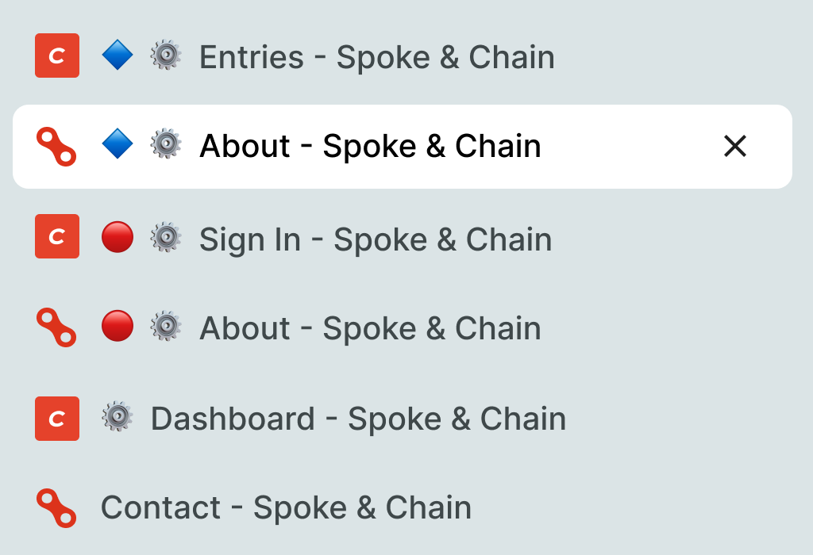

# Environment Banner plugin for Craft CMS

Marks Craft environments so you can tell them apart at a glance:

- A coloured banner across the top of the control panel.
- A coloured symbol at the start of every page `<title>` (CP and front end), so browser tabs are easy to tell apart.

The defaults mark `dev`/`development` with a blue diamond 🔷 and `staging` with a red circle 🔴. Shape differs as well as colour, so it works for colour-blind users. Environments that are not listed (such as `production`) get nothing.



## Requirements

This plugin requires Craft CMS `5.0.0` or later.

## Installation

To install the plugin, follow these instructions.

1.  Open your terminal and go to your Craft project:

        cd /path/to/project

2.  Then tell Composer to load the plugin:

        composer require simplygoodwork/craft-environment-banner

3.  In the Control Panel, go to Settings → Plugins and click the “Install” button for Environment Banner.

## Configure

It works with no config. To change it, create `config/environment-banner.php`:

```php
<?php

use craft\helpers\App;

return [
    // Defaults to Craft's CRAFT_ENVIRONMENT. Set it if your project uses a different variable.
    'environment' => App::env('ENVIRONMENT'),

    'environments' => [
        'dev' => ['label' => 'Local development', 'color' => '#2563EB', 'symbol' => '🔷'],
        'staging' => ['label' => 'Staging', 'color' => '#D80621', 'symbol' => '🔴'],
    ],

    'showBanner' => true,
    'prefixTitles' => true,
];
```

## Notes

The banner is a `::before` on `#page-container`. If a Craft release changes the CP markup, that selector is the one to revisit.

---

Brought to you by [Good Work](https://simplygoodwork.com).
